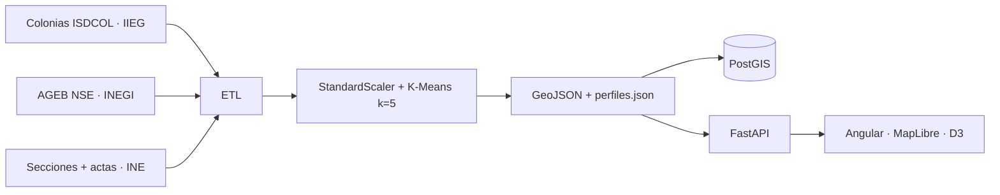

# Perfiles ciudadanos de participación — ZMG

**Hackatón INE · Reto 1**  
Piloto territorial para identificar **perfiles de participación ciudadana** en la Zona Metropolitana de Guadalajara y proponer **estrategias diferenciadas** de promoción del voto, útiles al Instituto Nacional Electoral.

> Datos **solo agregados por colonia**. Sin información personal identificable (PII).  
> Las estrategias son **por perfil (cluster K-Means)**, no una distinta por cada colonia: todas las colonias del mismo perfil heredan el mismo mensaje, canales y acciones.

**Repositorio:** [Perfiles-ciudadanos-de-participación](https://github.com/Roberto-rgb-code/Perfiles-ciudadanos-de-participaci-n)

### Demo en producción (Railway)

| Servicio | URL |
|----------|-----|
| **Frontend** | https://web-production-0eaf34.up.railway.app |
| API | https://api-production-f1ca.up.railway.app/api/health |

Proyecto Railway: `perfiles-ccpc-zmg` · servicios `web` + `api` + `Postgres`.  
Scripts: `deploy/railway-deploy.ps1`.

---

## ¿Qué resuelve?

El Reto 1 pide entender *quién participa y cómo* en el territorio, para orientar comunicación institucional. Este sistema:

1. Integra sociodemografía, nivel socioeconómico y participación electoral a **nivel colonia**.
2. Segmenta el universo ZMG con **K-Means (k = 5)** en perfiles interpretables.
3. Expone un **tablero web** (mapa, fichas, estadísticas, estrategias e informe PDF) listo para demo y evaluación.

Unidad de análisis: **colonia**. La participación llega desde **sección electoral** (join espacial); el NSE desde **AGEB** (asignación por centroide).

---

## Universo espacial

| Alcance | Municipios |
|---------|------------|
| ZMG (piloto) | Guadalajara, Zapopan, Tlaquepaque, Tonalá, Tlajomulco de Zúñiga, El Salto, Juanacatlán, Ixtlahuacán de los Membrillos |

Incluye colonias en límites con municipios compuestos (p. ej. `Guadalajara,Zapopan`) para no dejar huecos cartográficos.

---

## Fuentes oficiales

| Fuente | Qué aporta |
|--------|------------|
| **INE** | Cartografía electoral (sección/municipio) y participación en diputaciones locales 2018, 2021 y 2024 |
| **IIEG Jalisco** | Sociodemográfico por colonia (ISDCOL): población, edad, sexo, escolaridad, vivienda, etc. |
| **INEGI** | Nivel socioeconómico AGEB (Jalisco), transferido a colonia |

---

## Metodología (resumen)

### Pipeline



1. **Universo** — Filtrar colonias ISDCOL de municipios ZMG.  
2. **Sociodemografía** — % jóvenes 18–24, % 60+, % mujeres, escolaridad promedio.  
3. **NSE** — AGEB → centroide de colonia → puntuación ordinal 1–9.  
4. **Participación** — Tasas por sección → colonia (within / nearest); series 2018, 2021, 2024 y delta.  
5. **Segmentación** — Features estandarizadas + K-Means; clusters ordenados por participación media; narrativa y estrategia INE por perfil.  
6. **Producto** — API + dashboard (mapa temático, tour guiado, PDF).

### Variables del clustering

- % jóvenes 18–24  
- % adultos 60+  
- % mujeres  
- Escolaridad promedio  
- Nivel socioeconómico  
- Participación 2018, 2021 y 2024  
- Delta de participación 2018 → 2024  

### Privacidad y límites

Solo datos territoriales agregados. No hay predicción individual de voto. Las campañas son **orientativas** para focalizar comunicación institucional del INE.

Detalle en la app: ruta **Metodología**.

---

## Qué incluye la interfaz

| Módulo | Función |
|--------|---------|
| **Mapa** | Choropleth por perfiles y capas temáticas (NSE, participación, sociodemografía). Radiografía al clic en colonia. Escala, geolocalización, opacidad. Tour Driver.js por UI y **todas las capas**. |
| **Perfiles** | Fichas narrativas de cada cluster. |
| **Estadísticas** | Visualizaciones D3 (distribuciones, comparativos). |
| **Estrategias INE** | Mensaje, tono, canales y acciones **por perfil**; búsqueda/filtros; PDF filtrado. |
| **Metodología** | Fuentes, pipeline, variables y elaboración. |
| **Informe PDF** | Exportación real (jsPDF) con perfiles, métricas y estrategias. |

Inicio = mapa (`/mapa`). Logo / Inicio / atrás del navegador regresan al mapa.

---

## Stack

| Capa | Tecnología |
|------|------------|
| Frontend | Angular 18, Tailwind, MapLibre GL (OpenFreeMap), D3.js, Driver.js, jsPDF, Icônes/Iconify |
| Backend | FastAPI, GeoPandas, scikit-learn (K-Means) |
| Datos | PostgreSQL 16 + PostGIS |
| Ops | Docker Compose, Jenkinsfile (lint / build / deploy QA) |

---

## Cómo levantarlo

Requisitos: **Docker Desktop** (o Docker Engine + Compose).

```powershell
cd segmentador_ccpc_zmg
docker compose up --build
```

| Servicio | URL / acceso |
|----------|----------------|
| UI | http://localhost:8080 |
| API health | http://localhost:8000/api/health |
| Docs API | http://localhost:8000/docs |
| PostGIS | `localhost:5433` · usuario/contraseña/db: `ccpc` / `ccpc` / `segmentador_zmg` |

La primera corrida del contenedor `api` ejecuta el ETL (puede tardar varios minutos) y deja listos los artefactos.

Forzar regeneración del pipeline:

```powershell
$env:FORCE_ETL=1; docker compose up --build api
```

### API principal

| Método | Ruta | Descripción |
|--------|------|-------------|
| GET | `/api/health` | Estado de artefactos |
| GET | `/api/perfiles` | Perfiles + metadatos del universo |
| GET | `/api/perfiles/{id}` | Detalle de un cluster |
| GET | `/api/geojson` | Colonias con `cluster_id` y atributos |
| GET | `/api/stats` | Resumen para gráficos |
| POST | `/api/pipeline/run` | Disparar ETL (según configuración) |

---

## Datos del repositorio

Entrada (montada en el contenedor API):

| Carpeta en `data/raw/` | Contenido |
|------------------------|-----------|
| `Sociodemografico/` | Colonias CPV / ISDCOL + diccionario |
| `Nivel_socioeconomico/` | AGEB NSE Jalisco |
| `Cartografia_electoral/` | Sección + municipio |
| `electoral/` | Resultados / participación 2018–2024 |

Salida procesada:

- `data/processed/colonias_clusters.geojson`  
- `data/processed/perfiles.json`  

Este proyecto es **autónomo** respecto a otros repos del workspace: solo consume la copia en `data/raw/`.

---

## Elaboración

**Kevin Roberto Torres Ruiz · Nadine Valeria Montoya Rabago · Guillermo Ruiz Fernández**

Hackatón INE · Reto 1 — Perfiles ciudadanos de participación (piloto ZMG).
