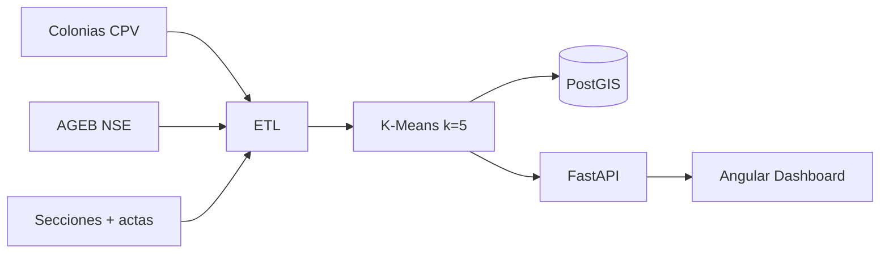

# Perfiles ciudadanos de participación — ZMG (Reto 1 INE)

Prototipo de hackatón: **perfiles de participación ciudadana** con clustering K-Means sobre datos **agregados** (sin PII) de la Zona Metropolitana de Guadalajara.

**No mezcla código con `miguel-gis`.** Solo usa una copia de capas en `data/raw/`.

## Universo

| Alcance | Municipios ZMG |
|---------|----------------|
| Piloto | Guadalajara, Zapopan, Tlaquepaque, Tonalá, Tlajomulco, El Salto, Juanacatlán, Ixtlahuacán de los Membrillos |

Unidad de análisis: **colonia** (sociodemográfico CPV) + participación por **sección** (join espacial) + NSE AGEB.

## Stack

- **Angular 18** + Tailwind + **MapLibre GL** (OpenFreeMap) + **D3.js** + iconos animados [Icônes / Iconify](https://icones.js.org/) (`line-md`, `svg-spinners`)  

- **FastAPI** + Scikit-learn (K-Means) + GeoPandas  
- **PostgreSQL 16 + PostGIS**  
- **Docker Compose** (volúmenes persistentes)  
- **Jenkinsfile** (lint / build / deploy QA)

## Levantar (Docker)

```powershell
cd C:\Users\User\Documents\miguel_gis\segmentador_ccpc_zmg
docker compose up --build
```

| Servicio | URL |
|----------|-----|
| UI | http://localhost:8080 |
| API | http://localhost:8000/api/health |
| PostGIS | localhost:5433 · user/pass/db `ccpc` / `ccpc` / `segmentador_zmg` |

Primera corrida: el contenedor `api` ejecuta el ETL (puede tardar varios minutos) y luego sirve la API.

Forzar regeneración:

```powershell
$env:FORCE_ETL=1; docker compose up --build api
```

## Datos en `data/raw/`

| Carpeta | Contenido |
|---------|-----------|
| `Sociodemografico/` | Colonias CPV + diccionario |
| `Nivel_socioeconomico/` | AGEB NSE Jalisco |
| `Cartografia_electoral/` | SECCION + MUNICIPIO |
| `electoral/` | Diputados locales 2018/2021/2024 |

Artefactos: `data/processed/colonias_clusters.geojson`, `perfiles.json`.

## Vistas UI

1. **Mapa** — choropleth por perfil predominante  
2. **Perfiles** — fichas narrativas  
3. **Estadísticas** — Chart.js  
4. **Estrategias INE** — campañas diferenciadas  

## Metodología (jurado)

- Features: % joven, % 60+, % mujeres, escolaridad (`GRAPROES`), NSE, tasas participación 2018≈/2021/2024, delta.  
- `StandardScaler` + `KMeans(k=5)`.  
- Narrativa + estrategias = plantillas institucionales por cluster.  
- Fuente de participación: actas diputaciones locales (proxy CCPC multi-elección). Sociodemografía: CPV colonia + NSE AGEB.

## Pipeline visual



## CI

Ver `Jenkinsfile`: pytest, build Angular, `docker compose build`, deploy QA en `main`.
